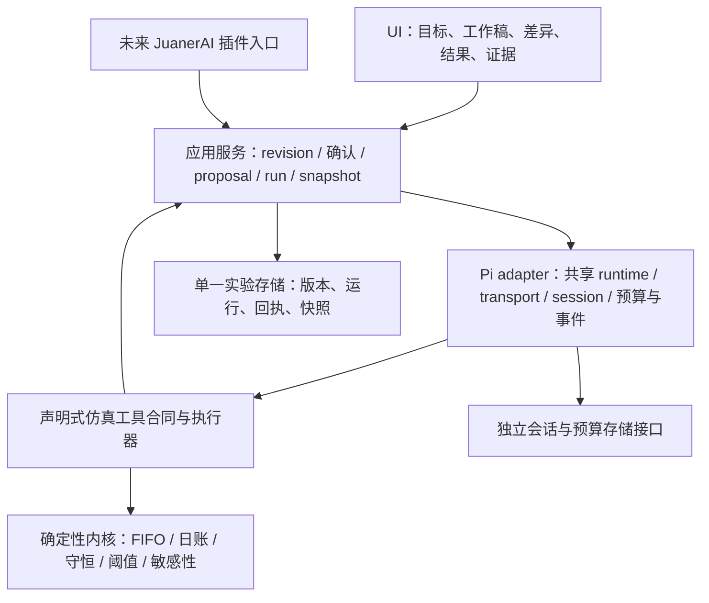

# SimLab 经营仿真实验室 · 产品方案 v0.2

2026-10-20｜产品评审与交互原型｜全部示例合成。界面版本 v0.2，确定性模型版本仍为 `simlab-daily-fifo-0.1.0`。

## 1. 产品决定

做一个让业务负责人在活动开始前看清“哪里先撑不住、何时调整、会付出什么代价”的经营实验工作台。默认从经营目标自然语言开始，Agent 先组织可讨论的实验草稿，用户修改假设、比较方案，再沿着每日库存、履约队列与现金追溯结果。

第一期只做促销、库存、履约联动：30 天、单 SKU、单仓、一单一件、确定性 FIFO。三种方案是基准促销、提前备货、分批限量。Agent 负责理解、提议和解释；可验证的内核负责数值与守恒。结果用于支持选择，不能把合成情景表述为预测、最优策略、因果效果或采购批准。

先作为独立工具验证使用价值，未来再通过小而明确的接口成为 JuanerAI 插件。本次没有修改 metric-factory、JuanerAI 或其他既有项目；没有正式产品开发、部署、依赖安装、密钥读取或真实付费模型调用。

## 2. 相对 v0.1 的变化与不变

| 维度 | v0.1 | v0.2 |
| --- | --- | --- |
| 起点 | 参数与仪表盘先行 | 经营目标 → 可讨论草稿 → 对齐口径 → 运行 |
| 工作布局 | 仿真控制台 | 230px 导航、64px 顶栏、五个工作视图、右侧共创助手 |
| 修改 | 直接输入后重跑 | 保留直接编辑；新增结构化建议、差异与真实计算影响、采纳 / 放弃 |
| 一致性 | 参数脏标记与运行快照 | 工作稿 revision、确认 revision、运行 revision 分离；改稿使旧确认和结果过期 |
| 证据 | 轨迹、阈值与导出 | 日账、敏感性、守恒、口径、历史快照集中可见 |
| Agent 架构 | 接缝方向 | 明确复用当前 Pi runtime、工具合同、会话 / 事件 / 取消 / 恢复责任 |
| 验证 | 417 次模型运行；DOM 桩 | 原测试复用回归 + 真实 Chromium 桌面 / 窄屏、点击与实际 JSON 下载 |

**原样保留：**14 个可调数值参数、2 个布尔冲击、30 天窗口、三方案、需求乘数与区间、供货延迟、FIFO、取消时序、采购政策、现金与贡献毛利口径、阈值、真实单变量敏感性、逐日账及 JSON 全量结果。原内核文本逐字一致，SHA-256：

`8e6d44d5402c595673bb727ed9500aadc8222ac905067c93f69a7e7bcc7a48ca`

第一版完整 ZIP、原 MD 和解包的 7 个源交付保留在相邻 `../v0.1/`；v0.2 的 ZIP 另含第一版原 ZIP 的字节副本。未将 v0.1 原 UI 桩测试伪称为 v0.2 浏览器验证。

## 3. metric-factory 的当前事实与参考原型

本次在 MacBook 只读检查 `/Users/huangbo/Dev/Projects/metric-factory`。分支 `main`，HEAD `169faa8d45e1c5616c004f8fb844a7ca68add156`。初始未提交状态为以下未跟踪项目，未触碰它们：

```text
?? .codebase-memory/
?? .flow/archive-m3-20261018/state.json
?? my-instance/
```

检查过的路径祖先与仓内未发现适用的 AGENTS.md；读取了项目 package、UI 源码、LLM adapter 和已安装 runtime 类型。当前 UI 使用现有 dist，在新输出目录作为工作目录、强制 faux 模式启动，仅浏览 GET 页面，未在参考仓运行 build、测试或写操作。完整事实与行号见 [借鉴证据](research/metric-factory-evidence.md)，前后 Git 状态见 research JSON。

| 来源 | 可确认的事实 | SimLab 的具体借鉴 |
| --- | --- | --- |
| 当前 `src/ui/public/index.html` / `style.css` | 灰绿侧栏、暖白主面、230px 导航、64px 顶栏、绿色主动作、细边框、中文系统字 | 复用这一产品壳和密度；靠排版、分隔与状态组织信息 |
| 当前 `src/ui/public/app.js` / `api.js` | 自然语言入口、可选模板、工作视图、右侧助手、建议差异、采纳 / 放弃、确认与版本 | 一份实验稿在五视图间往返，助手始终围绕同一稿；结果是中心工作成果 |
| 当前 `src/llm/index.ts` / `pi-client.ts` | 中立 LlmClient，createPiTransport → createPiClient → createRuntime().runText() | SimLab 将 Pi 类型和调用收敛到 adapter；不在 UI 或内核散落 provider 调用 |
| 2026-10-18 认可原型及 `screenshots-v0.2` | 同一工作稿、可讨论草稿、先展示修改影响、采纳更新、旧确认失效、固定版本 | 将认可的协作方式用于经营实验，不搬指标树或指标模板业务 |

**必须区分：**当前 metric-factory 已有真实后端工作台及无工具文本模型调用；此前认可原型是独立合成交互。当前 `pi-client.ts` 没有注册业务工具、没有使用 `runAgent` / `createSessionRuntime`，没有暴露 UI 停止 / 续接接口。不能因为 runtime 包提供这些 API，就宣称 metric-factory 已把完整 Agent 会话投入生产。

## 4. 用户与最短闭环

主要用户是活动 / 业务负责人，供应链与财务同看假设和结果。要判断的不是某个最高总分，而是“为何选这个方案、什么条件变化会推翻选择”。

1. 描述目标，例如大促需求上行、供货延迟时，提前备货还是分批限量。
2. Agent 给出初始理解、模型适用范围、参数来源、三方案与待确认假设；未知事实留空或明确用合成默认值。
3. 用户直接编辑或提出自然语言修改。先看结构化差异、影响预览，再采纳 / 放弃。
4. 确认当前稿的口径与假设，主动运行三方案。确认不是模型正确性的替代，也不是业务行动批准。
5. 在同一外部环境下看比较、现金低点、贡献毛利和积压；点击风险日或用滑块看 D0–D30 日账。
6. 查看守恒、单变量敏感性、期末资产与未完成队列，再形成有条件的判断。
7. 固定不可变快照并下载全量依据。继续修改同一工作稿时，旧快照保留，旧确认失效。

## 5. UI 结构与设计原则

密度选择：起步页舒适，实验页平衡，日账局部紧凑。以下原则在原型中已经体现：

- 先呈现业务理解和可控选择，再展开参数与计算细节。
- 主工作区承载成果，右侧助手辅助修改，不让聊天记录替代实验资产。
- 自然语言与直接表单共享同一份状态；建议不是自动写入。
- 结果保留自己的输入身份；旧结果可以看，但必须醒目标记过期。
- 状态同时使用文字、控件禁用和颜色；图表单位明确，不把现金与件数混在同一轴。

| 视图 | 内容与主要动作 |
| --- | --- |
| 实验总览 | 目标、适用边界、三方案差异、共同冲击与护栏、口径确认 |
| 参数与情景 | 所有 v0.1 参数、单位、范围和冲击；保存 / 放弃编辑 |
| 运行与结果 | 三方案比较、单方案逐日轨迹、D0–D30 日账、风险首触日与持续天数、期末状态 |
| 证据与口径 | 三方案 / 敏感性运行校验、计算定义、内核版本与 SHA、完整日账 |
| 检查与快照 | 输入、确认、运行一致性与守恒检查；固定快照和历史下载；故障体验入口 |

230px 左栏含新实验、我的实验、可选场景模板和最近稿；64px 顶栏保留上下文和持续可见的脚本标记。工作区标题行只有运行这一主动作。助手先展示差异与基于原内核的影响，保留“采纳 / 放弃”。

窄屏隐藏固定左栏，以菜单展开；助手放在成果之后；工作视图导航与宽日账在局部横向滚动。保留键盘焦点、表单标签、原生 dialog、Esc 关闭、滑块键盘操作、aria 状态与零分母“不适用”。桌面和窄屏截图均由真实浏览器产生。

## 6. 不变的模型与完整参数

| 参数 | 默认值 | 单位 / 范围 |
| --- | ---: | --- |
| 窗口 days | 30 | 固定，D1–D30，D0 单独记额外备货 |
| 基准需求 demand | 180 | 单 / 天，整数 0–5,000 |
| 初始库存 inventory | 1,800 | 件，整数 0–100,000，期前已付 |
| 发货能力 capacity | 250 | 件 / 天，整数 0–10,000 |
| 采购提前期 leadTime | 5 | 天，整数 1–30 |
| 集中促销增幅 promo | 80 | %，0–200；分批方案减半并铺开双倍时长 |
| 单件售价 price | 128 | 元 / 件，0–100,000 |
| 商品成本 cost | 72 | 元 / 件，0–100,000 |
| 履约费 fulfillmentCost | 9 | 元 / 发货件，0–1,000 |
| 持有费 holdingCost | 0.15 | 元 / 日末现货件 / 天，0–100 |
| 初始现金 cash | 180,000 | 元，0–100,000,000，额外 D0 采购前 |
| D0 额外备货 extraStock | 900 | 件，整数 0–100,000，仅提前备货方案 |
| 最大等待 maxWait | 3 | 天，整数 0–30，下单日年龄为 0 |
| 现金底线 cashThreshold | 20,000 | 元，0–100,000,000，严格小于触发 |
| 积压上限 backlogThreshold | 500 | 件，整数 0–100,000，严格大于触发 |
| 需求冲击 demandShock | 开启 | D8–D21 的需求再乘 1.30 |
| 供货冲击 supplyShock | 开启 | 四笔计划采购提前期 +3 天，D0 现货不受影响 |

**默认区别说明：**v0.1 方案描述过常态与各个压力情景；其实际 HTML 的 DEFAULTS 同时开启两项冲击。v0.2 组合压力样例严格保留实际默认值，另提供无额外冲击、仅需求冲击两条起步路径；表单可以自由组合两项开关。

基准和提前备货均在 D8–D14 增需 `promo%`；分批在 D8–D21 增需 `promo/2%`、每日最多接 `capacity` 单。需求在生成时取整；未受理需求不进入队列，不自动回流。提前备货 D0 取得额外现货，库存增加且现金立即减少 `extraStock × cost`。

每日顺序：到货 → 生成并接收订单 → FIFO 发货 → 发货尝试后超时取消 → 确认收款、成本、履约与持有费 → 固定计划采购并付款 → 保存日末状态和阈值。

- 发货量 = min(可用库存, 日发货能力, 待发订单)。库存不得负、不得超能力。
- 未发订单满足 `当前日 − 下单日 ≥ maxWait` 才取消。默认 D1 订单在 D4 发货尝试后仍未发才取消；不是退款。
- D1、D8、D15、D22 每次下单 `round(demand × 7)` 件。到货日 = 下单日 + 提前期 + 供货延迟。超出 D30 的在途继续作为已付资产保留。
- 贡献毛利 = 发货件数 ×（售价 − 商品成本 − 变动履约费）。模型经营结余 = 贡献毛利 − 持有费；不是净利润。
- 日末现金 = 前日现金 + 发货收款 − 当日采购付款 − 履约费 − 持有费。原有库存不重复扣现金，发货仍确认成本。
- 现金低点含 D0；没有声称捕捉日内最低现金。现金可负，之后的曲线是忽略融资约束继续推演。
- 现货、在途、订单、需求分解和现金都可复核；不把期末队列全算取消，不强行清算存货。
- 潜在需求发货率、已接单发货率、已接单取消率分母不同；零分母显示“不适用”。库存不足与能力不足可共存，不能将同一未发订单损失重复相加。

敏感性严格沿用原实现：分别对需求 −20%、需求 +20%、发货能力 −20%、采购提前期 +2 天独立重跑。原采购日、采购量及分批接单上限冻结。修改工作稿的能力会联动改变分批上限、修改基准需求会改变采购量，这属于修改经营政策，不能与敏感性混称。

需求回落在 v0.2 中仍只通过“需求 −20%”敏感性展示，没有新增主情景的回落冲击。多 SKU、多仓、退货、融资、税费、固定费用、需求反馈、随机分布和自动优化仍不在模型中。

## 7. Pi SDK 驱动的正式产品底座

**复用对象是当前实际安装的 `pi-agent-runtime@0.4.3`，不另写 Agent loop。**参考仓通过 `file:vendor/pi-agent-runtime-0.4.3.tgz` 使用它。runtime 包内部精确依赖 `@earendil-works/pi-agent-core@0.86.1` 与 `@earendil-works/pi-ai@0.86.1`。metric-factory 根依赖另有 `@earendil-works/pi-ai@0.87.1`；不能把根版本当作 runtime 的内部版本。包内 README 首段仍提 0.4.1，版本判断以 package、lock、已安装类型为准。

metric-factory 的实际路径：UI 请求 → `src/ui/server.ts` 创建草稿任务 → `generateBlueprintDraft` / `generateDraft` → `LlmClient.complete` → `createPiClient` → `createRuntime().runText()` → `createPiTransport`。候选链、密钥指纹、审计目录和预算配置决定缓存身份。`onEvent` 捕获成功 `model.finished` 的真实 provider / model；业务输出还要过产品 validator。

SimLab 正式产品规划在相同 adapter 边界内使用 runtime 已提供的工具与会话能力：

- 一次性工具任务可用 `runAgent({taskId, prompt, tools, limits, signal, contextVersions})`。循环、模型候选和授权 / 预算 / 超时 / 审计机制交给 runtime。
- 需要持续讨论与恢复的实验使用 `createSessionRuntime`、`create()` 和 `run({sessionId, operation, tools, ...})`。提供宿主 `SessionStorage`、持久预算账本、`bindOperation`、`reconcile`；不把浏览器 localStorage 当作正式会话存储。
- 同一业务会话只有一种引擎和一个写入者。session 负责对话上下文；实验 revision、proposal、run、snapshot 由应用服务管理，两者不能混为一张聊天记录。
- 只装配声明过的仿真工具。没有通用 shell、任意网络、宿主文件写入或真实采购工具。读工具可以合理并行，采纳、执行、快照等变更按 revision 串行校验。
- UI 订阅应用服务投影的状态；runtime `onEvent` 是观察，不是持久提交或授权通道。`tool.finished` 不等于实验成功；只有内核校验和结果提交成功才可展示成功。

**本次边界：**原型没有导入 Pi 包，没有真实模型设置页、凭据、联网模型调用、生产 session、durable writer lock、跨进程预算或审计。底层接法是经过当前代码核对的实施方案，不是“已经连通”的声明。

## 8. 分层架构与权威边界



| 层 | 负责 | 不拥有的权威 |
| --- | --- | --- |
| UI | 输入、展示差异、明确采纳、确认与运行、定位证据 | 不写公式、不伪造运行状态 |
| 应用服务 | 版本前置条件、参数校验、工具语义、幂等回执、结果提交与导出 | 不另造模型推理循环 |
| Pi adapter | 当前共享 SDK 接入、task / session 绑定、预算、超时、事件映射 | 不直接改实验账或批准参数 |
| 仿真工具 | 调用明确的应用命令与内核；返回结构化结果和来源 | 不允许自然语言绕过范围 / revision |
| 确定性内核 | 真正计算日序、队列、现金、守恒、阈值和敏感性 | 不猜业务事实、不解释成现实概率 |
| 存储 | 工作稿、提案、运行回执、不可变快照；记录关联身份 | 不以聊天文本代替账与结果 |

首期可用一个本地事务性实验存储；表 / 文件的物理形式待工程切片再定。模型定义与运行数据是逻辑对象，不要求先建“两套库”。不以完整本体、通用 Model Pack、插件市场或模型编辑器为前置。模型是版本化的固定能力，参数、情景、来源和限制可逐步扩展。

## 9. 自然语言修改闭环与版本

正式产品中，模型从已注册能力中提议模型与情景；无法表达的需求返回“模型不适用 / 缺参数 / 需新能力”，不能编出一组数字继续。

`理解目标 → inspect_model → propose_change → preview_change → 展示差异 / 影响 → 用户采纳 → apply_proposal → 旧确认失效 → 确认当前口径 → run_experiment → read_evidence → 有条件解释`

每条提案保存 baseRevision、结构化 patch、理由、来源、假设、影响预览及预览所用模型 / 参数身份。采纳在事务中检查 baseRevision；不匹配返回冲突，先重新预览，不默默覆盖。放弃不改稿、不使原确认失效。手动编辑和建议采纳使用同一应用命令。

运行冻结模型版本、输入、三方案、外部冲击、阈值与采购政策。结果始终绑定该 revision。修改目标或参数后旧确认失效；旧结果保持可见但标记过期，阻断以“当前结果”导出。历史快照独立下载，并清楚标为历史。

快照绑定目标、参数、确认版本、运行及模型 hash；固定后不随工作稿改变。没有修改的同一运行不重复发快照。本次 demo 的 run ID / revision / operation ID 是本地演示身份；正式版须增加服务端 inputHash / policyVersion / provenance，并对并发与事务做验收。

## 10. 工具合同贯穿模型与执行

详细字段、JSON 示例和错误映射见 [工具合同与 Pi 接点](工具合同与Pi接点.md)。所有工具通过中立 `Tool` 类型注册：name、description、effect、parameters、resourceUnits、executionMode、replay、execute。JSON Schema 说明参数结构，产品 validator 检查模型规则与版本前置条件。

| 能力 | 工具 / 应用命令 | 结果与限制 |
| --- | --- | --- |
| 发现与选模型 | inspect_model | 模型、schema、单位、范围、假设、不可建模项与 hash |
| 提议 | propose_change | revision 绑定的提案，不直接改工作稿 |
| 预览 | preview_change | 内核实际重跑差异、阈值变化、政策联动；不是 LLM 估数 |
| 采纳 | apply_proposal | 必须由当前 UI 采纳凭据驱动；CAS 更新 revision，旧确认失效 |
| 运行 | run_experiment | 输入冻结、幂等回执、三方案与敏感性、守恒结果 |
| 解释 | read_evidence | 指标定义、日账、订单 / 采购记录、阈值首触与残差；引用 runId |
| 查询与恢复 | get_operation / get_run | 按原 operationId 查询是否执行与提交；未知不得重放 |
| 固定 / 交付 | save_snapshot / export_snapshot | 当前确认且结果一致才固定；历史文件标识历史版本 |

Agent 可以在授权范围内组织纯读取与计算，但采纳工作稿、确认口径、固定版本等权威动作来自应用服务核验的 UI 行为，不能由模型说“用户已同意”替代。工具返回的数值与状态是解释唯一依据；解释须带 run / revision / 证据日，旧结果仅作历史说明。

## 11. 参数错误、执行失败、取消与结果未知

| 情况 | 已执行？ | 产品行为 |
| --- | --- | --- |
| 参数范围 / schema / revision 错误 | 否 | rejected_not_executed；指出字段，保留工作稿与旧结果；不启动内核 |
| 计算或提交已知失败 | 是或已进入执行，结果已知 | failed；记录阶段和原因；不生成成功结果，先处理原因再新建运行 |
| 计算前取消已确认 | 否 | cancelled_not_executed；保留旧结果 |
| 执行中收到取消 | 尚不能断言 | cancelling；传 AbortSignal，等待物理结束与回执，可能成功、失败、取消或未知 |
| 超时、断连、进程崩溃，不能确认效果 | 不确定 | unknown；阻断自动 / 手动重放，先查原 operation 与存储回执 |
| 查询确认已经成功 | 是 | 回收原结果，不重新计算；恢复同一 operation 关联 |

共享 runtime 的 failed / cancelled / blocked / suspended / waiting 是模型运行状态，不能直接推出仿真是否执行。尤其 `CANCELLED` / `DEADLINE_EXCEEDED` 不能证明写操作撤销。`unknown` 是本产品按回执权威判断的执行状态，不虚构为 SDK 的 Reason 枚举。

正式停止通过 signal 传递；同步内核需迁到受控 worker 并在日步 / 批次边界响应。`waitForIdle(taskId)` 等待物理收尾，未收尾不释放会话写入者。恢复前用 SDK reconcile 对齐 task / session / budget / 外部回执；未知返回 unknown 并停止推进。不能因模型备选切换而再执行一遍未知工具，不能叠加产品重试和 runtime modelRecovery。

Demo 实现 900ms 运行前等待，可实际取消该等待；同步内核开始后不能被页面事件物理中断。故障注入可体验已知失败、计算已完成但回执丢失，以及查询后回收同一结果。它不是分布式恢复或持久执行系统。刷新时若存在运行中状态但无可查回执，会保持未知，不伪称安全重试。

## 12. 独立工具与未来 JuanerAI 插件

独立工具先提供目标草稿、固定模型、运行与证据、版本导出。后续插件只适配入口、身份授权、参数 / 结果引用与文件交付：JuanerAI 调用应用服务，仍由同一工具合同和内核执行；不把业务账搬进宿主 Agent prompt，不修改宿主循环。

接缝以 modelVersion、input snapshot / hash、runId、operationId、snapshotId、evidence references、scope / units / limitations 为核心。metric-factory 可作为未来业务口径来源，但同名指标不自动等价；本次没有建立数据连接、转换现有仓库模型、修改宿主或接入真实业务系统。

建议分四个工程切片，均为后续规划：① 固化独立内核服务与回归；② 当前共享 runtime adapter、离线 transport 和完整工具合同；③ 原子回执 / 会话恢复与真实模型的单独有界联调；④ 验证独立用户价值后再做 JuanerAI 插件。真实模型调用、正式开发或接入权限均需另行明确范围。

## 13. 原型已实现与尚未实现

| 已在本地 demo 实现 | 仍为产品规划 / 限制 |
| --- | --- |
| 三条自然语言起步样例、可选模板 | 任意自由文本理解；只支持明确列出的修改句式 |
| 结构化修改、真实影响、采纳 / 放弃 | 真 Pi Agent、provider 选择、session 与工具注册 |
| revision、确认失效、过期结果、原运行不变 | 服务端事务、CAS、inputHash、并发编辑 |
| 三方案、全部原参数、冲击、日账、护栏、敏感性 | 多品多仓、随机模型、真实预测与优化 |
| 当前 JSON 下载、历史固定快照、浏览器持久化 | 生产持久回执、审计、权限、备份与多人协作 |
| 计算前取消、已知失败 / 未知回执体验 | 执行中物理取消、跨进程 / 断电恢复 |

入口会明确提示脚本边界。自由输入未识别时不生成假的模型、建议或成功反馈；目标文本修改只改说明，不假装已经重解参数。

## 14. 验收与判断标准

数值验收：原 v0.1 测试不改，作为 v0.2 的回归；原内核内容 hash 一致。覆盖逐日与窗口守恒、边界、随机确定性输入、FIFO 超时、D0 现金、零需求、延迟在途、冻结政策的单变量敏感性。

交互验收：真实 Chromium 点击样例、生成稿、确认、运行、查看日账与敏感性、真实下载；建议预览不写稿、放弃不改变、采纳使旧确认 / 结果过期；非法输入未执行、取消、失败、未知先查询；历史快照不被覆盖；桌面与窄屏无整页横向溢出。具体本次结果见 [使用与验证说明](使用与验证说明.md) 与 validation 记录。

试用应验证：用户能否指出静态测算遗漏的瓶颈；是否能复述关键口径；是否能说清选择的代价和重审条件；是否据此改变方案或增加明确护栏。运行次数、聊天轮数和漂亮图表不作为经营价值证明。
